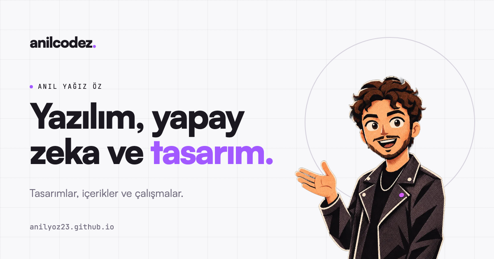

# anilcodez

Anıl Yağız Öz'ün kişisel sitesi. Yazılım, yapay zeka ve tasarım üzerine içerikler, çizimler ve çalışmalar.

**Canlı site:** [aniloz.dev](https://aniloz.dev/)



## Neler var?

- **Açık / koyu tema.** Site cihazın ayarına uyar. Butonla seçilen tema, cihaz ayarı değişene kadar hatırlanır.
- **Çalışmalar.** İçerik serileri ve projeler için kartlar (ör. Fırsat Radarı).
- **İletişim.** E-posta, Instagram, LinkedIn ve GitHub bağlantıları.
- **Bağlantılar sayfası.** [/links](https://aniloz.dev/links/) Linktree yerine kullanılan, site temasında link-in-bio sayfası.
- **DM sayfaları.** `/dm/` altında Instagram DM otomasyonunun gönderdiği sayfalar; ilki [/dm/claude-video](https://aniloz.dev/dm/claude-video/) (5 araç + tek dokunuşla kopyalanan kurulum prompt'u).
- **Özel 404 sayfası.** Yapay zeka sohbeti tarzında, "yanıtı yeniden oluştur" butonlu.
- **Paylaşım önizlemesi.** Link WhatsApp, Instagram ya da LinkedIn'de kapak görseliyle görünür.
- **Hafif.** Framework yok, build adımı yok. Tek HTML dosyası, WebP görseller, yerel fontlar.

## Dosya yapısı

```
index.html     Ana sayfa (HTML, CSS ve JS tek dosyada)
dm/            DM otomasyonundan gelenler için sayfalar
links/         Instagram biyografisi için bağlantılar sayfası
404.html       Bulunamayan sayfalar için hata ekranı
CNAME          Özel alan adı (aniloz.dev)
robots.txt     Arama motorlarına tarama izni
sitemap.xml    Arama motorları için sayfa listesi
assets/        Görseller, favicon, paylaşım kapağı ve fontlar
```

## Bilgisayarda açmak

```bash
python3 -m http.server 8791
```

Sonra tarayıcıda `http://localhost:8791` adresine git.

## Güncelleme

1. `index.html` içinde değişikliği yap.
2. Yeni bir çalışma eklemek için `<div class="projects">` içindeki bir `<article class="project">` bloğunu kopyalayıp başlık, açıklama, görsel ve bağlantıyı değiştir. Görseller `assets/` içinde WebP olarak durur, açık ve koyu tema için ayrı birer sürüm kullanılır.
3. Commit atıp `main` dalına gönder. GitHub Pages siteyi bir iki dakika içinde yayına alır.

## Yazım notu

Sitede "yapay zeka" ve "hikaye" şapkasız yazılır.

## İletişim

- E-posta: [anilcodez@gmail.com](mailto:anilcodez@gmail.com)
- Instagram: [@anilcodez](https://www.instagram.com/anilcodez/)
- LinkedIn: [anilyoz](https://www.linkedin.com/in/anilyoz)

## Lisanslar

Fontlar kendi lisanslarıyla kullanılır: Satoshi ([assets/Satoshi-Lisans-FFL.txt](assets/Satoshi-Lisans-FFL.txt)) ve JetBrains Mono ([assets/JetBrainsMono-Lisans-OFL.txt](assets/JetBrainsMono-Lisans-OFL.txt)). Çizimler ve içerikler Anıl Yağız Öz'e aittir.
